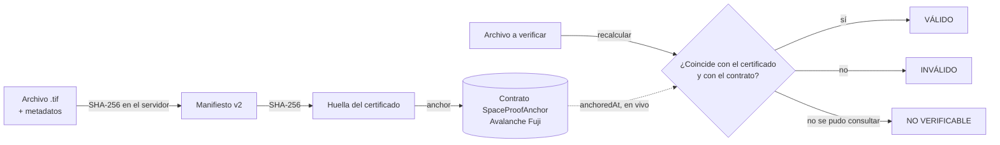
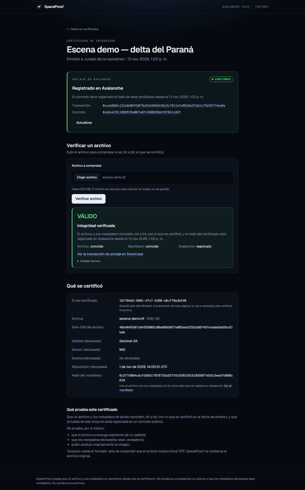
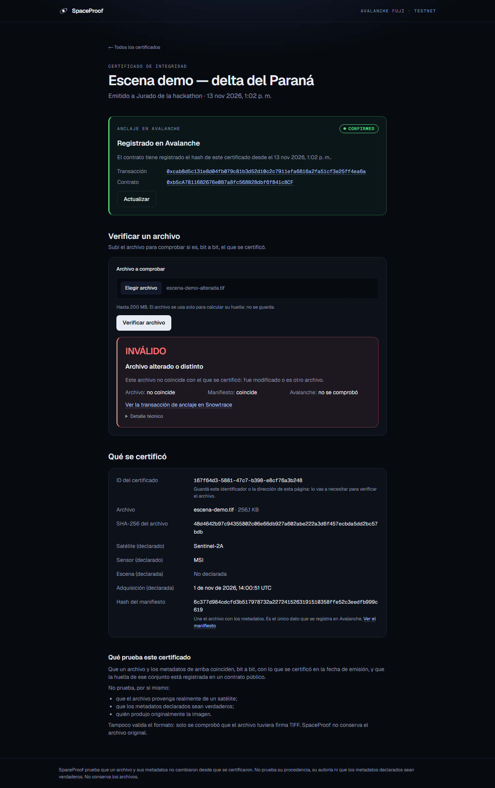

<p align="center">
  
</p>

<h1 align="center">SpaceProof</h1>

<p align="center"><strong>Integridad verificable de archivos y datos satelitales.</strong><br>
Certificá un archivo junto con sus metadatos, anclá su huella en Avalanche y comprobá después, sin confiar en nadie, que no cambió.</p>

---

## El problema

Una imagen satelital pasa por muchas manos antes de usarse como evidencia: se descarga, se recorta, se reenvía. Quien la recibe no tiene cómo saber si el archivo y los datos que lo acompañan (satélite, fecha de adquisición, escena) son exactamente los que alguien certificó en su momento. Un hash guardado en la base de quien lo emitió no alcanza: quien controla esa base puede cambiar los datos y recalcular el hash.

## Qué hace SpaceProof

1. **Certifica.** El servidor recibe el archivo en flujo, calcula su SHA-256 y lo une a los metadatos declarados en un *manifiesto* determinista. El SHA-256 de ese manifiesto es la huella del certificado.
2. **Ancla.** Esa huella —y solo ella— se registra en un contrato público de Avalanche, con la fecha del bloque. Nadie, tampoco SpaceProof, puede borrarla ni cambiarla.
3. **Verifica.** Cualquiera vuelve a subir el archivo: SpaceProof recalcula todo y consulta el contrato en vivo. Un solo bit distinto, o un metadato alterado, y la verificación falla.



## Qué garantiza y qué no

| Garantiza | No garantiza |
|---|---|
| Que el archivo es, bit a bit, el que se certificó | Que el archivo provenga realmente de un satélite |
| Que los metadatos son los que se declararon al certificar | Que esos metadatos sean verdaderos |
| Que la huella está registrada en un contrato público desde una fecha | Quién produjo originalmente la imagen |
| Que un resultado «válido» se obtuvo consultando la blockchain en ese momento | La validez del formato: solo se comprueba la firma TIFF |

Tres reglas que el sistema no rompe:

- **Nunca dice «válido» sin la respuesta de la blockchain.** Si no se pudo consultar, el resultado es «no verificable», no «válido» ni «inválido».
- **No conserva los archivos.** Los bytes pasan por memoria mientras se calcula el hash; no van a la base, al disco ni a los backups. El usuario conserva su original.
- **En la blockchain solo hay hashes.** Ni archivos, ni metadatos, ni datos personales.

## Verificalo vos mismo

No hace falta confiar en SpaceProof:

1. `sha256sum archivo.tif` → debe ser el SHA-256 que muestra el certificado.
2. Abrí el manifiesto del certificado (`GET /api/certificates/:id/manifest`): contiene ese hash y los metadatos. Su SHA-256 es la huella del certificado.
3. Consultá `anchoredAt(0x<huella>)` en el contrato, desde el explorador o cualquier RPC: devuelve la fecha del anclaje, o `0` si no está.

La forma exacta del manifiesto está en [docs/manifiesto-v2.md](docs/manifiesto-v2.md).

## Contrato en Avalanche Fuji

| | |
|---|---|
| Red | Avalanche Fuji C-Chain (testnet), chain ID 43113 |
| Contrato `SpaceProofAnchor` | [`0xb5cA7811682676e0B7a8fc568B28dbf6f841c8CF`](https://testnet.snowtrace.io/address/0xb5cA7811682676e0B7a8fc568B28dbf6f841c8CF) |
| Código fuente verificado | [Sourcify](https://sourcify.dev/server/repo-ui/43113/0xb5cA7811682676e0B7a8fc568B28dbf6f841c8CF) (coincidencia exacta) |
| Interfaz | `anchor(bytes32)` solo el owner, una vez por hash · `anchoredAt(bytes32)` público · evento `Anchored` |

Mínimo a propósito: sin proxy, sin transferencia de ownership, sin forma de borrar una entrada. Detalle en [contracts/README.md](contracts/README.md).

## Arquitectura

```
Navegador ──▶ Frontend (Next.js) ──▶ Backend (NestJS) ──▶ PostgreSQL
                 interfaz               API REST            certificados y
                 proxy de /api          hash en flujo       estado del anclaje
                                            │
                                            └──▶ Avalanche Fuji (viem)
                                                 lee el contrato en cada verificación
                                                 envía y confirma los anclajes
```

- **Backend** — emite, ancla y verifica. El envío a la cadena es recuperable: el hash de cada transacción se guarda antes de difundirla, y un anclaje solo figura confirmado cuando el recibo, el evento del contrato y el valor almacenado coinciden.
- **PostgreSQL** — los certificados son inmutables y no se pueden borrar (permisos y triggers); la aplicación corre con privilegios mínimos.
- **Contrato** — la fuente de verdad. La base solo guarda el seguimiento del envío.

| Capa | Tecnología |
|---|---|
| Frontend | Next.js 16, React 19, Tailwind CSS 4 |
| Backend | NestJS 11, Prisma 7, viem |
| Base de datos | PostgreSQL 17 |
| Contrato | Solidity 0.8.28, Hardhat 3 |
| CI | GitHub Actions: backend, e2e con PostgreSQL, frontend, contrato |

## Ejecutarlo en local

Requisitos: Node.js 22, pnpm 10, Docker.

```bash
npm install && npm run install:all        # dependencias
cp backend/.env.example backend/.env      # completar las contraseñas
cd backend
pnpm db:up                                # PostgreSQL de desarrollo
pnpm exec prisma migrate deploy           # esquema
cd .. && npm run dev                      # http://localhost:3000
```

Para leer el contrato de Fuji, descomentá `ANCHOR_RPC_URL` y `ANCHOR_CONTRACT_ADDRESS` en `backend/.env`. Para que el backend además **envíe** los anclajes hace falta `ANCHOR_PRIVATE_KEY`, la clave del owner del contrato: con ella, cada certificado genera una transacción.

Guía completa (roles, variables, pruebas, backups, despliegue): [docs/OPERACION.md](docs/OPERACION.md).

## Así se ve

| Certificado anclado y verificación válida | Copia con un bit cambiado |
|---|---|
|  |  |

## Demo

Guion de dos minutos, con archivos de ejemplo reproducibles: [docs/DEMO.md](docs/DEMO.md).

```bash
node scripts/demo-files.mjs   # genera demo/escena-demo.tif y su copia con un bit cambiado
```

## Estado

MVP para hackathon, en testnet. El contrato está desplegado y verificado; el backend emite, verifica y lee la cadena en vivo. El ciclo completo se probó con una transacción real en Fuji: el backend emitió un certificado, ancló su huella ([transacción](https://testnet.snowtrace.io/tx/0xcab8d5c131e8d04fb079c81b3d52d10c2c7911efa6816a2fa51cf3e25ff4ea6a)), la confirmó y verificó el archivo original (válido) y una copia con un bit cambiado (inválido). La recuperación ante fallos está probada contra una cadena simulada. El despliegue público todavía no está preparado. Estado detallado, decisiones y pendientes: [docs/ESTADO_Y_PENDIENTES.md](docs/ESTADO_Y_PENDIENTES.md).

| Documento | Contenido |
|---|---|
| [docs/API_EMISION_VERIFICACION.md](docs/API_EMISION_VERIFICACION.md) | Contrato de la API |
| [docs/manifiesto-v2.md](docs/manifiesto-v2.md) | Forma canónica del manifiesto y vectores de prueba |
| [docs/OPERACION.md](docs/OPERACION.md) | Instalación, operación y despliegue |
| [contracts/README.md](contracts/README.md) | Contrato, pruebas y despliegue |
